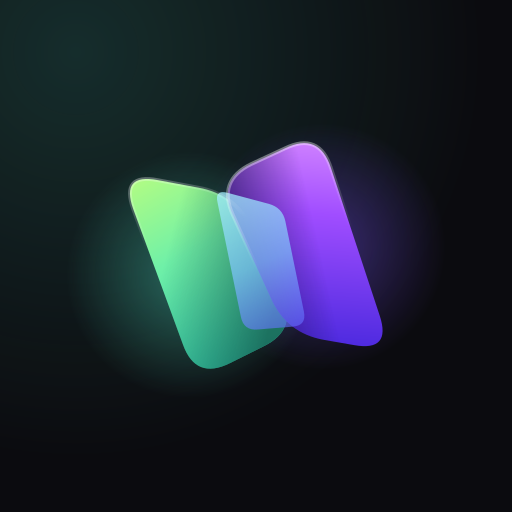

<p align="center"></p>

<h1 align="center">Velora</h1>
<p align="center"><b>Your screen. Anywhere.</b></p>

Open-source, low-latency remote control for your own computers: view and drive a Windows or
Linux PC from another PC or from your Android phone. It is designed around input
responsiveness and a picture that is always current, not around maximum image quality.

> **Status: early MVP.** Desktop host (Windows, Linux/X11), desktop client and Android app:
> pairing (QR code on phones), encrypted streaming, keyboard/mouse/touch, hardware encoding
> and decoding, signed auto-updates. iOS and NAT traversal are next (see [Roadmap](#roadmap)).

## How it works

```
 host (PC being controlled)                                client (PC / phone)
 ┌────────────────────────────────┐   QUIC (UDP, TLS 1.3)   ┌──────────────────────────────┐
 │ capture  DXGI / X11 SHM+Damage │ ─ video: 1 stream/frame ─▶ decode  ─▶ latest-frame slot │
 │ encode   H.264 (OpenH264)      │ ◀─ acks, keys, buttons ──  (reliable control stream)    │
 │ inject   SendInput / uinput    │ ◀─ pointer moves ───────── (unreliable datagrams)       │
 └────────────────────────────────┘                          └──────────────────────────────┘
```

Latency decisions:

- **Pointer moves are QUIC datagrams.** A lost position is replaced by the next one instead of
  being retransmitted behind newer data. Clicks carry their own position, so they land where
  you saw the cursor even if a move was lost.
- **Keys, buttons and scroll use a reliable stream.** A lost key-up would leave a key stuck. The
  host also tracks everything pressed and releases it when the client disconnects or loses focus.
- **Frames are acknowledged after decoding.** The host keeps at most
  `ceil(RTT / frame interval) + 2` frames in flight. When the network or the client falls behind,
  the host captures fewer frames instead of queuing them, so what you see is never stale.
- **Each frame is its own QUIC stream.** Frames don't block each other in the transport, and the
  client decodes them in order.
- **The cursor is drawn locally.** Your own OS cursor moves with zero network latency. The host
  stream doesn't include its cursor.
- **Capture only on change.** DXGI Desktop Duplication and XDamage wake the pipeline only when
  the screen changes, so an idle desktop costs almost no CPU or bandwidth.
- **Keys are physical (scan codes), not characters.** Shortcuts, games and dead keys behave as on
  a local keyboard. Text is produced by the **host's** keyboard layout, so set it to match your
  physical keyboard (e.g. ABNT2).

Measured on a 4-core cloud VM with host, client and a virtual display on the same machine,
full-screen scrolling text at 1080p (worst case for the encoder): about 40 fps and 25-30 ms
from capture to decoded frame with CPU encoders. GPU encoders haven't been benchmarked by the
project yet (no GPU in CI).

## Project layout

| Crate | Purpose |
|---|---|
| `crates/protocol` | Wire format, TLS/QUIC configuration with certificate pinning, pairing codes, identity storage |
| `crates/host` (`velora-host`) | Capture, color conversion and encoding, input injection, sessions |
| `crates/client-core` | UI-independent client: connection, input API, decoding. Mobile apps will reuse it through FFI |
| `crates/client` (`velora`) | Desktop client: launcher (egui) for pairing, devices and settings; session window (winit + softbuffer) |
| `crates/mobile` (`velora-mobile`) | Client core exported to the mobile apps through [UniFFI](https://mozilla.github.io/uniffi-rs/) |
| `crates/uniffi-bindgen` | Generates the Kotlin (later Swift) bindings for `velora-mobile` |
| `android/` | Android app (Kotlin): MediaCodec hardware decoding, trackpad, soft and physical keyboards |
| `crates/update` | Self-updates from GitHub Releases |
| `crates/release` (`velora-release`) | Release tooling used by CI: packaging and the update manifest |

## Installing

On Windows, run `velora-<version>-x86_64-pc-windows-msvc-setup.exe` from the
[releases page](https://github.com/Yanngc32/Velora/releases). It installs for your user, without
administrator rights, into `%LOCALAPPDATA%\Programs\Velora`, and adds Velora to the Start menu
and to Installed apps. The installer is not code-signed, so SmartScreen warns about it the first
time: choose **More info → Run anyway**. After an automatic update, Installed apps may still show
the version first installed. Uninstalling removes the app and its "Start with Windows" entry, but
not the lock screen service: turn **This PC → Access on the lock screen** off first, or run
`velora-host service uninstall` as administrator.

Otherwise, download `velora-<version>-<target>.zip` for Windows or Linux (x86-64). Extract it to a
directory **your user can write to**, so updates can be installed, for example
`%LOCALAPPDATA%\Velora` or `~/.local/share/velora`. The archive contains
both `velora-host` and `velora` and the FFmpeg libraries for hardware encoding.

### Updates

Release builds keep themselves up to date:

- `velora-host run` checks one minute after start and then every 6 hours. When it finds a new
  version, it installs it and restarts once nobody is connected and no pairing code is open.
- `velora` checks in the background when it connects. The new version is used the next
  time it starts.
- `velora-host update` and `velora update` update immediately. Pass `--no-update` or set
  `VELORA_NO_UPDATE=1` to turn background updates off. Builds made from source never update
  themselves.

Each release carries `manifest.json`, which lists every file with its SHA-256. Updates come
over HTTPS from this repository's releases only, which are trusted as published (there is no
separate signing key). Before installing anything, an update checks:

- that the version is newer than the installed one (no downgrades);
- that every path stays inside the install directory;
- each file's hash and size.

Only files that changed are downloaded, so the FFmpeg libraries aren't fetched again unless
they changed. Files are swapped in by renaming. If any step fails, the update is rolled back,
and the previous files are removed on the next start.

## Building

Requirements: Rust 1.95+ and a C/C++ compiler (OpenH264 is built from source by the
`openh264` crate).

```sh
cargo build --release
# binaries: target/release/velora-host, target/release/velora
```

### Hardware encoding (recommended)

The default build encodes and decodes in software (OpenH264). For the GPU, build with the
`ffmpeg` features, which link the FFmpeg libraries (libavcodec, libavutil) dynamically:

```sh
# Linux (Debian/Ubuntu): FFmpeg development packages and clang (for bindgen)
sudo apt install libavcodec-dev libavutil-dev pkg-config clang
cargo build --release --features velora-host/ffmpeg,velora/ffmpeg

# Windows: an LGPL *shared* FFmpeg build (e.g. BtbN's win64-lgpl-shared) and LLVM
set FFMPEG_DIR=C:\path\to\ffmpeg     # contains include\ and lib\
cargo build --release --features velora-host/ffmpeg,velora/ffmpeg
# then copy the avcodec-*.dll, avutil-*.dll and swresample-*.dll from FFMPEG_DIR\bin next to the .exe files
```

`velora-host run --encoder auto` (the default) picks the first encoder that opens:
NVENC, then AMF, then Quick Sync on Windows, and NVENC, then VA-API, then Quick Sync on Linux.
If none opens, it falls back to software. To force one, pass `--encoder nvenc|amf|qsv|vaapi|software`,
or `--encoder ffmpeg:<name>` for any FFmpeg encoder. All hardware encoders are configured for
low latency: no B-frames, CBR, no lookahead, and keyframes only on demand.

On the viewing side, `velora` draws on the GPU (OpenGL 3.3 / ES 3.0, software fallback). A
build with `ffmpeg` also decodes on the GPU: on Windows, D3D11VA decodes and the D3D11 video
processor converts the picture, which the window shows in place through `WGL_NV_DX_interop2`
(measured at 1080p: 2.7 ms per frame against 6–8 ms for OpenH264, and less CPU). Without the
interop, and with VA-API on Linux, the picture is copied back to memory, which is slower than
OpenH264 up to 1080p: then the GPU takes over only when the CPU falls behind (more than 12 ms
per frame, say at 4K). `VELORA_DECODER=gpu` or `software` forces one.

On Linux, VA-API needs the driver for your GPU (`intel-media-driver` or `mesa-va-drivers`)
and access to `/dev/dri/renderD128` (the `render` group).

Linux runtime requirements:

- Host: an **X11** session (Wayland is not supported yet), plus write access to `/dev/uinput`
  for input injection. Without it the host runs view-only. Example udev rule:

  ```sh
  echo 'KERNEL=="uinput", GROUP="input", MODE="0660", OPTIONS+="static_node=uinput"' \
    | sudo tee /etc/udev/rules.d/60-velora-uinput.rules
  sudo usermod -aG input "$USER"   # then log out and back in
  ```

- Client: `libxkbcommon-x11` (X11) or a Wayland compositor.

## Usage

On the computer to control:

```sh
velora-host run --pair
```

This prints a single-use pairing code, valid for 10 minutes, a QR code for the phone, and the
exact command to run on the other device.

On a desktop, open **Velora** (`velora` with no arguments) and paste the code or the
`velora://` link under **Connect**. Paired computers are listed under **Devices**, one click
away; each session opens in its own window. The same is available from the command line:

```sh
velora pair 192.168.0.10:7420 VL1-...      # first time: pairs, saves the host and connects
velora connect <host-name>                 # afterwards
velora list                                # paired hosts
velora bench <host-name> --seconds 10      # headless throughput/latency check
```

Client shortcuts: **Ctrl+Alt+Shift+F** toggles fullscreen, **Ctrl+Alt+Shift+Q** quits.

Host management:

```sh
velora-host clients                 # paired devices
velora-host revoke <name|fingerprint>
velora-host password [--clear]      # password paired devices must also type to connect
velora-host run --fps 60 --bitrate 12000 --bind 0.0.0.0:7420 --encoder auto
```

The Velora app does the same under **This PC**: turn sharing on, show the pairing QR code,
see which devices are paired and connected, remove them, and set the access password.
**Settings → Start with Windows** opens the app and/or turns sharing on at sign-in.

### Lock screen access (Windows)

**This PC → Access on the lock screen** (or `velora-host service install` as administrator)
installs Velora as a Windows service. It copies the app to `C:\Program Files\Velora`, keeps
the host's state in `C:\ProgramData\Velora` (readable only by SYSTEM and administrators,
paired devices and password are carried over), and starts the host as SYSTEM in the console
session. The host then follows the lock screen, UAC prompts and the logon screen, and runs
from boot. Installing also adds a Windows Firewall rule, "Velora (service)", that lets the host
receive UDP on port 7420 on private and domain networks: a service never gets Windows' "allow
access" prompt. `velora-host service uninstall` removes the service and the rule. Under the
service, only administrators can pair or remove devices and change the password.

When a second paired device connects, it takes over the session. Switching from the phone to
the laptop just works.

### Files between computers

Both computers need this version or later.

- **In a session**, drop files or folders on the window: they go to the remote computer's
  Downloads folder. On the remote computer, **Send to → Velora** in Explorer sends the
  selection back to your Downloads folder. The window title shows the progress.
- **Devices → Files** opens a file manager: this computer and the remote one side by side.
  Select and use **Send** or **Download**, drag rows from one side to the other, or drop files
  from Explorer on the window. It connects for files only, without video, so it also works
  while a session is open, and leaves that session alone.

Nothing is ever overwritten: a name that is taken gets a number (`photo (1).jpg`). Files are
written under a temporary name and appear only once complete; a cancelled or interrupted
transfer leaves nothing behind. Symbolic links are not followed.

Any paired device can browse and move files, as the user signed in on that computer: it could
already do so through the screen. Under the lock screen service, file access runs in a helper
process started as the signed-in user, never as SYSTEM, and is unavailable while nobody is
signed in.

### Android

Download `velora-<version>-android.apk` from the
[releases page](https://github.com/Yanngc32/Velora/releases) and install it (allow installing
from unknown sources). When a newer release is out, the app offers to update when it starts:
tap **Update** and confirm. Paired computers are kept. Debug builds, such as the
`velora-debug-apk` artifact of the **Android** workflow, are signed with another key: they
never update, and switching between them and a release means reinstalling (and pairing again).

1. On the computer, run `velora-host run --pair`. It prints a QR code.
2. In the app, tap **Scan QR code**. You can also type the address and code.
3. Next time, tap the computer in the list. Long-press it to forget it.

The screen works like a laptop trackpad, and the cursor is drawn on the phone, so it follows
your finger with no network delay:

| Gesture | Action |
|---|---|
| Drag one finger | Move the cursor |
| Tap | Left click |
| Tap, then touch again and drag | Hold the left button (drag and drop, select text) |
| Two-finger tap | Right click |
| Two-finger drag | Scroll |

The toolbar shows or hides the keyboard and has Esc, Tab, the arrows and Del. Ctrl, Alt, Win
and Shift latch: tap Ctrl, then `c`, to send Ctrl+C. Text from the soft keyboard is typed in
whatever layout the host uses, including accents through dead keys on Linux (`á`, `ã`, `ç`).
USB and Bluetooth keyboards send physical keys. The video is decoded in hardware by
MediaCodec, straight to the screen.

Building the app yourself needs the Android SDK and NDK, Rust with the
`aarch64-linux-android` and `x86_64-linux-android` targets, and
`cargo install cargo-ndk`. Then run `cd android && ./gradlew assembleDebug`. Gradle compiles
the Rust core and generates its Kotlin bindings.

### Access over the internet

Built-in NAT traversal is not implemented yet. Until then, either:

- use a mesh VPN such as Tailscale or WireGuard and connect to the host's VPN address
  (recommended), or
- forward **UDP** port 7420 on the host's router.

Every connection is authenticated and encrypted either way.

## Security model

- Each device has a long-lived self-signed certificate. There is no CA and no account server.
- The pairing code contains the host's certificate fingerprint and 128 random bits. The client
  pins the fingerprint, so even the first connection can't be intercepted, and proves it knows
  the secret over the encrypted channel. The host then stores the client's fingerprint. Codes
  are single use and expire.
- Every later connection is mutual TLS 1.3. The client checks the pinned host certificate and
  the host checks the client against its paired list.
- Keys and lists are stored in the OS config directory (`~/.config/velora` on Linux,
  `%APPDATA%\velora\config` on Windows), readable only by the user on Unix.
- Optional access password: paired devices must also send it (inside TLS) to open a session.
  Only a salted PBKDF2-SHA256 hash is stored; repeated wrong guesses lock that device out for
  a growing time.
- The launcher talks to the local host over a named pipe (Windows) or a Unix socket, open
  only to the user it serves, SYSTEM and administrators.
- File transfers use the same connection. The receiver checks every path it is sent: nothing
  can be written outside the chosen folder (no `..`, absolute paths, drive letters, alternate
  data streams or device names).

Windows limitations: without the service, input can't reach elevated windows unless
`velora-host` runs elevated, nor the secure desktop (UAC prompts, lock screen).

## Roadmap

1. **Zero-copy GPU pipeline.** Hardware encoders work today, but frames still go through CPU
   color conversion and an upload. Next: convert on the GPU (D3D11 video processor, VA-API VPP)
   and hand the DXGI texture straight to the encoder.
2. **Zero-copy decoding on Linux.** Windows decodes and shows pictures without leaving the
   GPU; VA-API still copies them back. Next: import the VA-API surface into EGL (dma-buf).
3. **Mobile:** an iOS app (Swift + VideoToolbox) on the same `velora-mobile` core. On Android:
   pinch to zoom, a direct-touch mode, and Play Store publishing.
4. **NAT traversal.** A self-hostable rendezvous server, UDP hole punching, and a relay fallback.
5. Wayland capture (xdg-desktop-portal + PipeWire), multi-monitor selection, cursor shape sync,
   clipboard, audio, relative mouse mode for games, adaptive bitrate.
6. A systemd user service; installers.

## Releasing (maintainers)

To publish a release, bump `version` in the workspace `Cargo.toml` and merge to `main`. When
`main` has a version without a matching `v<version>` tag, the Release workflow (pushing that
tag by hand does the same):

1. builds Windows and Linux with FFmpeg (Linux on Ubuntu 22.04, for a low glibc requirement);
2. smoke-tests the packaged binaries;
3. builds the Android APK, signed with the release key, and checks the key;
4. writes the update manifest;
5. publishes the GitHub release and creates the tag.

The Android release key lives in the `ANDROID_KEYSTORE_BASE64` (a base64 PKCS#12 keystore,
alias `velora`) and `ANDROID_KEYSTORE_PASSWORD` secrets of the `release` environment, which only
`main` and `v*` tags may use, so pull request builds never get it. Keep a copy of it: installed
apps only accept updates signed with the same key, whose certificate fingerprint is pinned in
the Release workflow.

Merges that keep the version publish nothing.

Every installed copy picks the release up automatically, so treat push access to this
repository (and its tags) as access to every installation.

Pull requests that touch the release machinery run the same build as a dry run.

## License

MIT, see [LICENSE](LICENSE).

The desktop launcher bundles Inter and JetBrains Mono (SIL Open Font License) and Lucide icons
(ISC); their licenses are next to them in `crates/client/assets`.

H.264 is covered by patents. Cisco pays the royalties for OpenH264 only when users download
Cisco's prebuilt binary. This project compiles OpenH264 from source, which isn't covered.
Check your situation before distributing binaries. AV1, which is royalty-free, is on the
roadmap. FFmpeg is used under the LGPL: link it dynamically and use an LGPL build.
