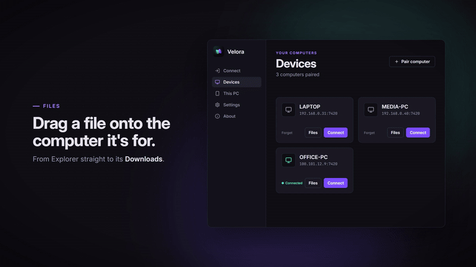

<p align="center"></p>

<h1 align="center">Velora</h1>

<p align="center">
  <b>Your screen. Anywhere.</b><br>
  Open-source, low-latency remote control for your own computers.
</p>

<p align="center">
  <a href="https://github.com/Yanngc32/Velora/releases/latest"></a>
  <a href="https://github.com/Yanngc32/Velora/actions/workflows/ci.yml"></a>
  <a href="LICENSE"></a>
  
  
</p>

<p align="center">
  <a href="https://github.com/Yanngc32/Velora/releases/latest"><b>Download</b></a> ·
  <a href="#quick-start">Quick start</a> ·
  <a href="#features">Features</a> ·
  <a href="#how-it-works">How it works</a> ·
  <a href="#building">Building</a> ·
  <a href="#roadmap">Roadmap</a>
</p>

<p align="center">
  <a href="docs/media/velora-tour.mp4"></a>
  <br>
  <sub><a href="docs/media/velora-tour.mp4">▶ Watch the full tour (38 s, with sound)</a> ·
  Music: “Happy Beats / Business Moves” by ende.app,
  <a href="https://creativecommons.org/licenses/by/4.0/">CC BY 4.0</a></sub>
</p>

View and drive a Windows or Linux PC from another PC or from your Android phone. Velora is
designed around input responsiveness and a picture that is always current, not around maximum
image quality.

> [!NOTE]
> **Status: early MVP.** Desktop host (Windows, Linux/X11), desktop client and Android app:
> pairing (QR code on phones), encrypted streaming, keyboard/mouse/touch, hardware encoding
> and decoding, signed auto-updates, and ways to reach a PC from other networks without a VPN
> (built and covered by automated tests, not yet tried on a range of real networks: see
> [Reaching this PC from anywhere](#reaching-this-pc-from-anywhere)). iOS is next (see
> [Roadmap](#roadmap)).

## Features

<table>
  <tr>
    <td width="33%" valign="top">
      <b>⚡ Low latency by design</b><br>
      QUIC over UDP. Pointer moves are datagrams, frames never queue up, and your own cursor
      is drawn locally.
    </td>
    <td width="33%" valign="top">
      <b>🎮 GPU end to end</b><br>
      NVENC, AMF, Quick Sync or VA-API encoding. On Windows, frames stay on the GPU from
      capture to encoder and from decoder to screen.
    </td>
    <td width="33%" valign="top">
      <b>📶 Adaptive bitrate</b><br>
      When the network falls behind, the bitrate drops to 70%, then climbs back step by step,
      with no keyframe.
    </td>
  </tr>
  <tr>
    <td valign="top">
      <b>🔐 Pair once, no accounts</b><br>
      A single-use code or QR code. Mutual TLS 1.3 with pinned certificates, no account
      server.
    </td>
    <td valign="top">
      <b>📁 Files between computers</b><br>
      Drop files on a device card or use the two-sided file manager, even between two remote
      computers. The receiver asks first.
    </td>
    <td valign="top">
      <b>📋 Shared clipboard</b><br>
      Text and images copied on one computer paste on the other, both ways.
    </td>
  </tr>
  <tr>
    <td valign="top">
      <b>🌍 Anywhere</b><br>
      With Tailscale or Netbird nothing else is needed. Without a VPN, Velora can open a router
      port, publish its address in the BitTorrent DHT or go through
      <a href="#reaching-this-pc-from-anywhere">another PC of yours</a>.
    </td>
    <td valign="top">
      <b>🔒 Lock screen access</b><br>
      As a Windows service, the host follows the lock screen, UAC prompts and the logon screen,
      and runs from boot.
    </td>
    <td valign="top">
      <b>📱 Android app</b><br>
      A laptop-style trackpad, soft and physical keyboards, and hardware decoding with
      MediaCodec.
    </td>
  </tr>
</table>

### Platforms

|  | Windows | Linux | Android | iOS |
|---|:---:|:---:|:---:|:---:|
| **Share this computer** (host) | ✅ | ✅ X11 | — | — |
| **Control another computer** (client) | ✅ | ✅ | ✅ | planned |

## Quick start

1. **Install** Velora on both devices from the
   [releases page](https://github.com/Yanngc32/Velora/releases/latest) (see
   [Installing](#installing)).
2. **Share:** on the computer to control, open **Velora → This PC**, turn sharing on and
   choose **Show QR code**.
3. **Pair:** on the other computer, paste the code or the `velora://` link under
   **New pairing**. On a phone, tap **Scan QR code**.
4. **Connect:** paired computers are listed under **Devices**, one click away.

## Installing

### Windows

Run `velora-<version>-x86_64-pc-windows-msvc-setup.exe` from the
[releases page](https://github.com/Yanngc32/Velora/releases). It installs for your user, without
administrator rights, into `%LOCALAPPDATA%\Programs\Velora`, and adds Velora to the Start menu
and to Installed apps. At the end it asks once for administrator rights (UAC) to add a Windows
Firewall rule, "Velora", that lets other devices reach the host on UDP port 7420 on any
network, Public ones included; declining leaves sharing reachable only where Windows' own
prompt allowed it.

> [!NOTE]
> The installer is not code-signed, so SmartScreen warns about it the first time: choose
> **More info → Run anyway**.

After an automatic update, Installed apps may still show the version first installed.
Uninstalling removes the app, its firewall rule and its "Start with Windows" entry, but not the
lock screen service: turn **This PC → Access on the lock screen** off first, or run
`velora-host service uninstall` as administrator.

### Windows and Linux archives

Download `velora-<version>-<target>.zip` for Windows or Linux (x86-64). Extract it to a
directory **your user can write to**, so updates can be installed, for example
`%LOCALAPPDATA%\Velora` or `~/.local/share/velora`. The archive contains both `velora-host`
and `velora` and the FFmpeg libraries for hardware encoding.

### Android

Download `velora-<version>-android.apk` from the
[releases page](https://github.com/Yanngc32/Velora/releases) and install it (allow installing
from unknown sources). See [Android](#android-1) for how to use it.

### Updates

Release builds keep themselves up to date:

- `velora-host run` checks one minute after start and then every 6 hours. When it finds a new
  version, it installs it and restarts once nobody is connected and no pairing code is open.
- `velora` checks in the background when it connects. The new version is used the next
  time it starts.
- `velora-host update` and `velora update` update immediately. Pass `--no-update` or set
  `VELORA_NO_UPDATE=1` to turn background updates off. Builds made from source never update
  themselves.

<details>
<summary><b>How updates are checked</b></summary>
<br>

Each release carries `manifest.json`, which lists every file with its SHA-256. Updates come
over HTTPS from this repository's releases only, which are trusted as published (there is no
separate signing key). Before installing anything, an update checks:

- that the version is newer than the installed one (no downgrades);
- that every path stays inside the install directory;
- each file's hash and size.

Only files that changed are downloaded, so the FFmpeg libraries aren't fetched again unless
they changed. Files are swapped in by renaming. If any step fails, the update is rolled back,
and the previous files are removed on the next start.

</details>

## Usage

### Desktop

On a desktop, open **Velora** (`velora` with no arguments) on the computer to control, go to
**This PC**, turn sharing on and choose **Show QR code**; on the other computer, paste the code
or the `velora://` link under **New pairing**. With **Also let it access this PC** on (and
sharing on here), the other computer pairs back by itself, so each can reach the other.
Paired computers are listed under **Devices** as cards, one click away; each session opens in
its own window.

**This PC** also shows which devices are paired and connected, removes them, sets the access
password and holds the switches for [reaching it from other
networks](#reaching-this-pc-from-anywhere). **Settings → Start with Windows** opens the app
and/or turns sharing on at sign-in.

On Windows, Velora also has an icon next to the clock. It shows whether this PC is shared and
who is connected, opens the app, and its menu turns sharing on and off or quits. Closing the
window leaves Velora there (**Settings → Keep running next to the clock when closed**), where
it announces devices asking to send files. Started at sign-in, it opens straight to the icon.

While sharing is on, the host keeps the computer from going to sleep, so it stays reachable
even when it sits locked for hours (**This PC → Keep this PC awake**, on by default). The
screen may still turn off, but stays on during a session. On Windows, `powercfg /requests`
lists both under Velora. A closed laptop lid still puts it to sleep.

Client shortcuts: <kbd>Ctrl</kbd>+<kbd>Alt</kbd>+<kbd>Shift</kbd>+<kbd>F</kbd> toggles
fullscreen, <kbd>Ctrl</kbd>+<kbd>Alt</kbd>+<kbd>Shift</kbd>+<kbd>Q</kbd> quits.

When a Windows host has several displays, a session starts on the main one and its window
title says which is shown ("Display 2 of 3").
<kbd>Ctrl</kbd>+<kbd>Alt</kbd>+<kbd>Shift</kbd>+<kbd>M</kbd> moves to the next display and
<kbd>Ctrl</kbd>+<kbd>Alt</kbd>+<kbd>Shift</kbd>+<kbd>1</kbd>…<kbd>9</kbd> picks one; the mouse
follows. A Linux host streams its whole desktop, every monitor at once.

When a second paired device connects, it takes over the session. Switching from the phone to
the laptop just works.

### Command line

On the computer to control:

```sh
velora-host run --pair
```

This prints a single-use pairing code, valid for 10 minutes, a QR code for the phone, and the
exact command to run on the other device:

```sh
velora pair 192.168.0.10:7420 VL1-...      # first time: pairs, saves the host and connects
velora connect <host-name>                 # afterwards; says which way in it took
velora wake <host-name>                    # wake a sleeping paired PC (Wake-on-LAN)
velora list                                # paired hosts
velora bench <host-name> --seconds 10      # headless throughput/latency check
```

Host management:

```sh
velora-host clients                 # paired devices
velora-host revoke <name|fingerprint>
velora-host password [--clear]      # password paired devices must also type to connect
velora-host run --fps 60 --bitrate 12000 --bind "[::]:7420" --encoder auto   # 0.0.0.0:7420: IPv4 only
velora-host run --relay-only        # no screen: only relays other devices (a VPS, say)
```

### Sound

On Windows, what the host plays comes out of the client during a session. It travels as Opus
at 96 kbit/s, 20 ms per datagram, through a short buffer: a lost packet is a 20 ms gap, never
a delay for the ones after it. <kbd>Ctrl</kbd>+<kbd>Alt</kbd>+<kbd>Shift</kbd>+<kbd>A</kbd>
mutes it. Sound needs builds with FFmpeg (the released ones) on both computers; Linux hosts
and the Android app don't send or play it yet.

### Lock screen access (Windows)

**This PC → Access on the lock screen** (or `velora-host service install` as administrator)
installs Velora as a Windows service. It copies the app to `C:\Program Files\Velora`, keeps
the host's state in `C:\ProgramData\Velora` (readable only by SYSTEM and administrators,
paired devices and password are carried over), and starts the host as SYSTEM in the console
session. The host then follows the lock screen, UAC prompts and the logon screen, and runs
from boot. Installing also adds a Windows Firewall rule, "Velora (service)", that lets the host
receive UDP on port 7420 on any network, Public ones included: a service never gets Windows'
"allow access" prompt. `velora-host service uninstall` removes the service and the rule. Under
the service, only administrators can pair or remove devices, change the password, turn the
[reach switches](#reaching-this-pc-from-anywhere) on or off and edit the relay lists.

### Shared clipboard

During a session, text and images copied on one computer can be pasted on the other, both
ways. Images travel as PNG (up to 32 MB). Turn it off under **Settings → Share the
clipboard**. Both computers need this version; with an older one, the clipboard stays apart.

### Files between computers

Both computers need this version or later.

- **In a session**, drop files or folders on the window: they go to the remote computer's
  Downloads folder. On the remote computer, **Send to → Velora** in Explorer sends the
  selection back to your Downloads folder. The window title shows the progress.
- **Devices**: drop files from Explorer on a computer's card to send them to its Downloads.
- **Devices → Files** opens a file manager with a computer on each side, this one or any paired
  one (pick it with the name at the top of the side). Select and use **Send to**, drag rows
  from one side to the other, or drop files from Explorer on the side that receives. Between
  two remote computers, files pass through this one (a temporary folder, removed afterwards).
  It connects for files only, without video, so it also works while a session is open, and
  leaves that session alone.

The computer receiving files asks first: "*X is asking to send files to this PC*", with the size
and where they go, **Accept** or **Decline**, and **Always accept from X** to skip the question
for that device from then on. Unanswered requests are declined after two minutes.

Nothing is ever overwritten: a name that is taken gets a number (`photo (1).jpg`). Files are
written under a temporary name and appear only once complete; a cancelled or interrupted
transfer leaves nothing behind. Symbolic links are not followed.

Any paired device can browse and move files, as the user signed in on that computer: it could
already do so through the screen. Under the lock screen service, file access runs in a helper
process started as the signed-in user, never as SYSTEM, and is unavailable while nobody is
signed in.

### Android

1. On the computer, run `velora-host run --pair`. It prints a QR code.
2. In the app, tap **Scan QR code**. You can also type the address and code.
3. Next time, tap the computer in the list. Long-press it to forget it.

The screen works like a laptop trackpad, and the cursor is drawn on the phone, so it follows
your finger with no network delay:

| Gesture | Action |
|---|---|
| Drag one finger | Move the cursor |
| Tap | Left click |
| Tap, then touch again and drag | Hold the left button (drag and drop, select text) |
| Two-finger tap | Right click |
| Two-finger drag | Scroll |

The toolbar shows or hides the keyboard and has Esc, Tab, the arrows and Del. Ctrl, Alt, Win
and Shift latch: tap Ctrl, then `c`, to send Ctrl+C. Text from the soft keyboard is typed in
whatever layout the host uses, including accents through dead keys on Linux (`á`, `ã`, `ç`).
USB and Bluetooth keyboards send physical keys. The video is decoded in hardware by
MediaCodec, straight to the screen.

When a newer release is out, the app offers to update when it starts: tap **Update** and
confirm. Paired computers are kept. Debug builds, such as the `velora-debug-apk` artifact of the
**Android** workflow, are signed with another key: they never update, and switching between
them and a release means reinstalling (and pairing again).

### Reaching this PC from anywhere

From another network a device needs an address that leads to this PC's UDP port. There are three
ways to get one, and they combine: a device keeps every address it knows for a PC and tries them
together (the usual one first, each other one 250 ms later), and the session opens on the first
that answers. All are optional, none needs an account, and none depends on a server run by
someone else (a relay PC is a computer of yours).

| | Right when | It needs |
|---|---|---|
| **A mesh VPN** (Tailscale, Netbird) | You already use one: still the easiest | The VPN on both sides. The host lists its mesh addresses (100.64.0.0/10, `fd7a:115c:a1e0::/48`) and tells every client |
| **Standalone reach** | No VPN, and this PC can be reached some way: a router port, IPv6 or a hole through the NATs | UPnP or NAT-PMP on the router, a public IPv6 address, or NATs that allow a punch |
| **A relay PC** | This PC is behind CGNAT or two routers | Another PC of yours, on and reachable: both ends connect out to it and it passes the packets along |

Standalone reach is three switches on **This PC → Reach from other networks** (sharing on), all
off until you turn them on:

| Switch | What it does |
|---|---|
| **Reach this PC from other networks without a VPN** | Asks the router to forward UDP 7420 (NAT-PMP, then UPnP) and tells your devices this PC's public and IPv6 addresses. Also lets it open a hole when a device asks and register with a relay PC. |
| **Find this PC when its address changes** | Publishes the PC's addresses in the BitTorrent Mainline DHT, sealed so that only your paired devices can read them. It lists what the first switch finds, so use both. |
| **Let my other PCs connect through this one** | Makes this PC a relay. A session through it uses as much of its internet as the picture's bitrate (12 Mbit/s at most by default), both ways. |

A device learns the addresses, the DHT key and the relays when it connects (both ends need a
version with these features; older ones keep using the addresses they have), so after changing a
switch connect once from each device while it can still reach the PC.

**The router** must answer UPnP or NAT-PMP, often a setting; the card then says *Port open on the
router*. If its own address is private or in 100.64.0.0/10, your provider shares one address
between customers (CGNAT) or a second router sits in front: no port can be opened, Velora
advertises nothing dead, and the DHT, a punch or a relay PC are what is left. A public IPv6
address is advertised too, but your router's IPv6 firewall must let UDP 7420 in: Velora cannot
open it. Forwarding the port by hand still works, as it always did.

**Windows.** The installer's firewall rule ("Velora", UDP 7420, any network) already covers the
port. As the lock screen service, changing a switch or a relay list needs administrator rights
(open Velora as administrator), and the service keeps its state in `C:\ProgramData\Velora`,
where the settings of your own host are copied when it is installed: look at **This PC** all the
same.

**A relay PC, in three steps** (**This PC → Relay PCs**, on both PCs):

1. Pair your phone or laptop with the relay PC, as usual.
2. On this PC, paste the relay PC's pairing link under *Relays this PC uses* and click *Use as
   my relay*. On the relay PC, paste this PC's link under *Computers allowed to use this PC as a
   relay*, click *Let it use this PC* and turn on *Let my other PCs connect through this one*. A
   PC shows its link under *Show QR code* → *Copy link* (open the relay PC's after its card shows a
   public address).
3. Pair your phone or laptop with this PC, as usual (a device paired earlier connects once from
   home to learn the relay).

The relay PC must itself be on and reachable: a port open on its router, which needs the first
switch on there too, or a VPS. This PC needs the first switch on as well.

**Waking a sleeping PC.** The **Wake** button on a PC's card, or `velora wake <name>`, sends a
Wake-on-LAN packet. It needs, and Velora cannot check:

- Wake on LAN on in the firmware (and, for a PC that is off rather than asleep, the "deep sleep"
  or ErP power saving off);
- in Windows, the adapter allowed to wake the PC on a magic packet and fast startup off, on a
  wired link (Wi-Fi wake depends on the adapter);
- a connection made once while the PC was on, so your device knows its adapter address;
- a sender on the PC's own network: your device itself when it is on that LAN (the laptop or
  phone on the home Wi-Fi), or a relay PC there that is on and has this PC registered. A router
  drops a magic packet that comes in from the internet.

*Wake-up signal sent* only says the packet left. From outside the home network the sender has to be a relay PC at
home that can itself be reached (a VPS is not on that network). The Android app has no Wake button
yet.

**Command line and headless hosts.** `velora connect` prints the way in it took (*through:
Public address · …*); `velora-host run --relay-only` serves relays and nothing else. A host with
no app keeps its settings in files in its state folder (`~/.config/velora/host`,
`%APPDATA%\velora\config\host`, or `C:\ProgramData\Velora\host` for the service): `reach.json`
(the three switches, read at start), `relays.json` and `relay_hosts.json`. Their format, a VPS
walk-through and the log lines to look for are in the [full guide](docs/standalone-reach.md).

**Limits.**

- The PC must be reachable some way: a mapped or forwarded port, IPv6, a punch, or a relay PC of
  yours.
- A punch needs NATs that keep one port per socket: a symmetric NAT on either end needs a relay.
- The DHT is IPv4 only and needs outbound UDP. The first connection through it can take a few
  seconds.
- A relay carries one device per PC at a time and all of the picture: as much upload as the
  bitrate. Its access password protects its own screen and is not asked of relay links.
- A removed device can still read the last DHT record for hours. It cannot connect.

> [!NOTE]
> **Status.** Automated tests cover the mapping (fake routers), NAT behaviour (a simulator), the
> DHT record, the relay (a whole session through it, with packet loss) and the app. Not yet
> confirmed on real networks: routers with and without UPnP, a real IP change, a relay between
> networks, hole punching, Android on mobile data. See
> [Status](docs/standalone-reach.md#status).

## How it works

```
 host (PC being controlled)                                client (PC / phone)
 ┌────────────────────────────────┐   QUIC (UDP, TLS 1.3)   ┌──────────────────────────────┐
 │ capture  DXGI / X11 SHM+Damage │ ─ video: 1 stream/frame ─▶ decode  ─▶ latest-frame slot │
 │ encode   H.264 (OpenH264)      │ ◀─ acks, keys, buttons ──  (reliable control stream)    │
 │ inject   SendInput / uinput    │ ◀─ pointer moves ───────── (unreliable datagrams)       │
 └────────────────────────────────┘                          └──────────────────────────────┘
```

Latency decisions:

- **Pointer moves are QUIC datagrams.** A lost position is replaced by the next one instead of
  being retransmitted behind newer data. Clicks carry their own position, so they land where
  you saw the cursor even if a move was lost.
- **Keys, buttons and scroll use a reliable stream.** A lost key-up would leave a key stuck. The
  host also tracks everything pressed and releases it when the client disconnects or loses focus.
- **Frames are acknowledged after decoding.** The host keeps at most
  `ceil(RTT / frame interval) + 2` frames in flight. When the network or the client falls behind,
  the host captures fewer frames instead of queuing them, so what you see is never stale.
- **Each frame is its own QUIC stream.** Frames don't block each other in the transport, and the
  client decodes them in order.
- **The cursor is drawn locally.** Your own OS cursor moves with zero network latency. The host
  stream doesn't include its cursor.
- **Capture only on change.** DXGI Desktop Duplication and XDamage wake the pipeline only when
  the screen changes, so an idle desktop costs almost no CPU or bandwidth.
- **Keys are physical (scan codes), not characters.** Shortcuts, games and dead keys behave as on
  a local keyboard. Text is produced by the **host's** keyboard layout, so set it to match your
  physical keyboard (e.g. ABNT2).

Measured on a 4-core cloud VM with host, client and a virtual display on the same machine,
full-screen scrolling text at 1080p (worst case for the encoder): about 40 fps and 25-30 ms
from capture to decoded frame with CPU encoders. GPU encoders haven't been benchmarked by the
project yet (no GPU in CI).

### Project layout

| Crate | Purpose |
|---|---|
| `crates/protocol` | Wire format, TLS/QUIC configuration with certificate pinning, pairing codes, identity storage |
| `crates/host` (`velora-host`) | Capture, color conversion and encoding, input injection, sessions |
| `crates/client-core` | UI-independent client: connection, input API, decoding. Mobile apps will reuse it through FFI |
| `crates/client` (`velora`) | Desktop client: launcher (egui) for pairing, devices and settings; session window (winit + softbuffer) |
| `crates/mobile` (`velora-mobile`) | Client core exported to the mobile apps through [UniFFI](https://mozilla.github.io/uniffi-rs/) |
| `crates/uniffi-bindgen` | Generates the Kotlin (later Swift) bindings for `velora-mobile` |
| `android/` | Android app (Kotlin): MediaCodec hardware decoding, trackpad, soft and physical keyboards |
| `crates/audio` (`velora-audio`) | The host's sound: WASAPI loopback capture and playback, Opus through FFmpeg |
| `crates/nat` (`velora-nat`) | Standalone reach: router port mapping (NAT-PMP, UPnP), public and IPv6 addresses, the endpoint a NAT shows, Wake-on-LAN |
| `crates/dht` (`velora-dht`) | The host's sealed record in the Mainline DHT, punch requests, and the DHT node that publishes and resolves them |
| `crates/relay` (`velora-relay`) | Relay framing and the core that copies QUIC packets between two connections |
| `crates/update` | Self-updates from GitHub Releases |
| `crates/release` (`velora-release`) | Release tooling used by CI: packaging and the update manifest |

## Building

Requirements: Rust 1.95+ and a C/C++ compiler (OpenH264 is built from source by the
`openh264` crate).

```sh
cargo build --release
# binaries: target/release/velora-host, target/release/velora
```

### Hardware encoding (recommended)

The default build encodes and decodes in software (OpenH264). For the GPU, build with the
`ffmpeg` features, which link the FFmpeg libraries (libavcodec, libavutil) dynamically:

```sh
# Linux (Debian/Ubuntu): FFmpeg development packages and clang (for bindgen)
sudo apt install libavcodec-dev libavutil-dev pkg-config clang
cargo build --release --features velora-host/ffmpeg,velora/ffmpeg

# Windows: an LGPL *shared* FFmpeg build (e.g. BtbN's win64-lgpl-shared) and LLVM
set FFMPEG_DIR=C:\path\to\ffmpeg     # contains include\ and lib\
cargo build --release --features velora-host/ffmpeg,velora/ffmpeg
# then copy the avcodec-*.dll, avutil-*.dll and swresample-*.dll from FFMPEG_DIR\bin next to the .exe files
```

`velora-host run --encoder auto` (the default) picks the first encoder that opens:
NVENC, then AMF, then Quick Sync on Windows, and NVENC, then VA-API, then Quick Sync on Linux.
If none opens, it falls back to software. To force one, pass `--encoder nvenc|amf|qsv|vaapi|software`,
or `--encoder ffmpeg:<name>` for any FFmpeg encoder. All hardware encoders are configured for
low latency: no B-frames, CBR, no lookahead, and keyframes only on demand.

On Windows, NVENC, AMF and Quick Sync take frames without them leaving the GPU: the D3D11
video processor converts the captured desktop to NV12 on the GPU that captured it, straight
into the encoder's own textures, and the CPU does none of it (measured with Quick Sync on an
Intel UHD 750: about 5 ms per 1080p frame). If that path fails, the host goes back to
converting on the CPU; `VELORA_ZERO_COPY=0` keeps it there.

The bitrate adapts to the network: `--bitrate` (12000 kbit/s by default) is the most. When
frames take well longer than usual to be acknowledged, or the host has to hold frames back,
it drops to 70% (down to a tenth of the most); once the path keeps up, it climbs back step by
step. The change applies in place, with no keyframe. `--fixed-bitrate` turns this off.

On the viewing side, `velora` draws on the GPU (OpenGL 3.3 / ES 3.0, software fallback). A
build with `ffmpeg` also decodes on the GPU: on Windows, D3D11VA decodes and the D3D11 video
processor converts the picture, which the window shows in place through `WGL_NV_DX_interop2`
(measured at 1080p: 2.7 ms per frame against 6–8 ms for OpenH264, and less CPU). Without the
interop, and with VA-API on Linux, the picture is copied back to memory, which is slower than
OpenH264 up to 1080p: then the GPU takes over only when the CPU falls behind (more than 12 ms
per frame, say at 4K). `VELORA_DECODER=gpu` or `software` forces one.

On Linux, VA-API needs the driver for your GPU (`intel-media-driver` or `mesa-va-drivers`)
and access to `/dev/dri/renderD128` (the `render` group).

### Linux runtime requirements

> [!IMPORTANT]
> The host needs an **X11** session: Wayland is not supported yet.

- Host: write access to `/dev/uinput` for input injection. Without it the host runs
  view-only. Example udev rule:

  ```sh
  echo 'KERNEL=="uinput", GROUP="input", MODE="0660", OPTIONS+="static_node=uinput"' \
    | sudo tee /etc/udev/rules.d/60-velora-uinput.rules
  sudo usermod -aG input "$USER"   # then log out and back in
  ```

- Client: `libxkbcommon-x11` (X11) or a Wayland compositor.

### Android app

Building the app yourself needs the Android SDK and NDK, Rust with the
`aarch64-linux-android` and `x86_64-linux-android` targets, and
`cargo install cargo-ndk`. Then run `cd android && ./gradlew assembleDebug`. Gradle compiles
the Rust core and generates its Kotlin bindings.

## Security model

- Each device has a long-lived self-signed certificate. There is no CA and no account server.
- The pairing code contains the host's certificate fingerprint and 128 random bits. The client
  pins the fingerprint, so even the first connection can't be intercepted, and proves it knows
  the secret over the encrypted channel. The host then stores the client's fingerprint. Codes
  are single use and expire.
- Every later connection is mutual TLS 1.3. The client checks the pinned host certificate and
  the host checks the client against its paired list.
- Keys and lists are stored in the OS config directory (`~/.config/velora` on Linux,
  `%APPDATA%\velora\config` on Windows), readable only by the user on Unix.
- Optional access password: paired devices must also send it (inside TLS) to open a session.
  Only a salted PBKDF2-SHA256 hash is stored; repeated wrong guesses lock that device out for
  a growing time.
- The launcher talks to the local host over a named pipe (Windows) or a Unix socket, open
  only to the user it serves, SYSTEM and administrators.
- File transfers use the same connection. The receiver checks every path it is sent: nothing
  can be written outside the chosen folder (no `..`, absolute paths, drive letters, alternate
  data streams or device names).

With [standalone reach](#reaching-this-pc-from-anywhere) on, what changes:

- **An exposed port.** The host accepts UDP from the internet on its port, as with a port you
  forward by hand. QUIC drops anything that is not a valid handshake for the host's certificate
  before Velora sees it, and while the host is exposed (standalone reach on, or relaying for
  others) each new address must also prove it can receive packets (QUIC Retry), so a forged first
  packet cannot make the host send more than it got. By default the host also listens on IPv6.
- **The DHT record** is signed with a key of its own, beside the TLS identity, and sealed
  separately for each paired device, so nobody else can read the addresses and a removed device is
  left out at the next publish. The DHT sees that an IP published under a key, when, and roughly
  how many devices can read it; no address, name or fingerprint.
- **A relay PC** copies encrypted QUIC packets between two authenticated connections. It cannot
  read or change a session, and forwards only for devices on its paired list.
- The DHT's public bootstrap nodes (and, only as a fallback when a device hole-punches, public
  STUN servers) see your IP address, as with any BitTorrent client. Nothing else leaves the
  computer and there is no telemetry. More in the
  [full guide](docs/standalone-reach.md#security-and-privacy).

> [!WARNING]
> On Windows, without the service, input can't reach elevated windows unless `velora-host`
> runs elevated, nor the secure desktop (UAC prompts, lock screen).

## Roadmap

1. **Zero-copy capture on Linux.** On Windows, captured frames reach the encoder without
   leaving the GPU; on Linux they are still converted on the CPU and uploaded. Next: VA-API VPP.
2. **Zero-copy decoding on Linux.** Windows decodes and shows pictures without leaving the
   GPU; VA-API still copies them back. Next: import the VA-API surface into EGL (dma-buf).
3. **Mobile:** an iOS app (Swift + VideoToolbox) on the same `velora-mobile` core. On Android:
   pinch to zoom, a direct-touch mode, and Play Store publishing.
4. **Standalone reach in the field.** It is built and tested against simulated routers and NATs;
   next come real routers and carriers (see
   [Status](docs/standalone-reach.md#status)). Known gaps: no Wake button in the Android app, no
   PCP or IPv6 pinholes, and a relay serves one device per PC at a time.
5. Wayland capture (xdg-desktop-portal + PipeWire), display selection on Linux, cursor shape sync,
   sound on Linux and Android, relative mouse mode for games.
6. A systemd user service; installers.

## Releasing (maintainers)

<details>
<summary><b>How a release is published</b></summary>
<br>

To publish a release, bump `version` in the workspace `Cargo.toml` and merge to `main`. When
`main` has a version without a matching `v<version>` tag, the Release workflow (pushing that
tag by hand does the same):

1. builds Windows and Linux with FFmpeg (Linux on Ubuntu 22.04, for a low glibc requirement);
2. smoke-tests the packaged binaries;
3. builds the Android APK, signed with the release key, and checks the key;
4. writes the update manifest;
5. publishes the GitHub release and creates the tag.

The Android release key lives in the `ANDROID_KEYSTORE_BASE64` (a base64 PKCS#12 keystore,
alias `velora`) and `ANDROID_KEYSTORE_PASSWORD` secrets of the `release` environment, which only
`main` and `v*` tags may use, so pull request builds never get it. Keep a copy of it: installed
apps only accept updates signed with the same key, whose certificate fingerprint is pinned in
the Release workflow.

Merges that keep the version publish nothing. Pull requests that touch the release machinery
run the same build as a dry run.

</details>

> [!CAUTION]
> Every installed copy picks a release up automatically, so treat push access to this
> repository (and its tags) as access to every installation.

## License

MIT, see [LICENSE](LICENSE).

The desktop launcher bundles Inter and JetBrains Mono (SIL Open Font License) and Lucide icons
(ISC); their licenses are next to them in `crates/client/assets`. The tour video's music is
“Happy Beats / Business Moves” by ende.app, under
[CC BY 4.0](https://creativecommons.org/licenses/by/4.0/).

> [!NOTE]
> H.264 is covered by patents. Cisco pays the royalties for OpenH264 only when users download
> Cisco's prebuilt binary. This project compiles OpenH264 from source, which isn't covered.
> Check your situation before distributing binaries. AV1, which is royalty-free, is on the
> roadmap. FFmpeg is used under the LGPL: link it dynamically and use an LGPL build.
